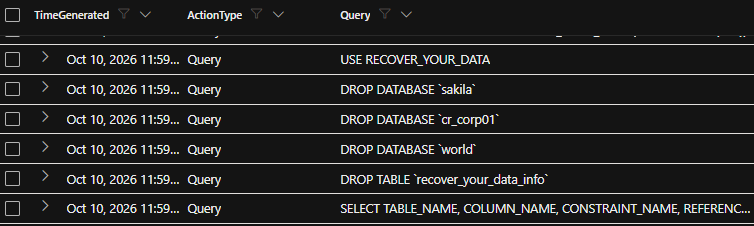
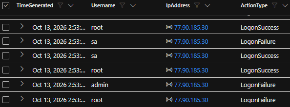
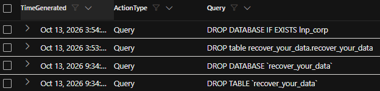

# SOC Incident Response: COPR-FIN-DB01 MySQL Compromise

## Overview

This project documents a SOC incident response investigation involving the Windows host `COPR-FIN-DB01` and its MySQL service.

The investigation identified successful remote privileged MySQL access, database enumeration, destructive SQL activity, ransomware-style extortion activity, and deletion of multiple databases and tables. The investigation also included a comparative DFIR review of pre-breach and post-breach Microsoft Defender for Endpoint investigation packages.

**Severity:** High  
**Affected Asset:** `copr-fin-db01`  
**Primary Evidence Window:** October 10–13, 2026  
**Incident Type:** Destructive database compromise / ransomware-style extortion

---

## Platforms and Tools

- Microsoft Defender for Endpoint
- Microsoft Sentinel / Log Analytics
- Kusto Query Language (KQL)
- MySQL Audit Logs
- Microsoft Defender for Endpoint Live Response Investigation Packages
- Windows Server
- PowerShell
- MITRE ATT&CK

---

## Incident Summary

The MySQL server on `copr-fin-db01` was compromised and subjected to destructive database activity.

The available logs confirm:

- Successful remote MySQL root authentication
- Database and table enumeration
- `SELECT` activity against database contents
- Creation of attacker-controlled `RECOVER_YOUR_DATA` objects
- Insertion of ransom instructions
- Deletion of tables and databases
- Revocation of write and destructive privileges from `root@%`
- Repeated authentication attempts against privileged accounts

The ransom message claimed that data had been copied by the attacker. However, confirmed data exfiltration could not be established from the available telemetry.

---

# Investigation

## 1. Identify Suspicious MySQL Activity

The first step was to search the MySQL audit logs for destructive commands and attacker-created recovery objects.

```kql
let START_TIME = datetime(2026-10-10T00:00:00Z);
let END_TIME = datetime(2026-10-14T00:00:00Z);
let MyDevice = "copr-fin-db01";

MySQLAudit_CL
| where TimeGenerated between (START_TIME .. END_TIME)
| where _ResourceId contains MyDevice
| extend Query = extract(@"Query\s+(.*)$", 1, RawData), ActionType = "Query"
| where Query contains "RECOVER_YOUR_DATA"
    or Query contains "DROP DATABASE"
    or Query contains "DROP TABLE"
    or Query contains "bitcoin"
| project TimeGenerated, ActionType, Query
| order by TimeGenerated desc
```

### Finding

The search identified:

- Ransom-related database objects
- `DROP TABLE` activity
- `DROP DATABASE` activity
- Cryptocurrency payment instructions
- Destructive activity affecting multiple databases



---

## 2. Investigate Remote MySQL Authentication

The next step was to determine whether the database accepted remote privileged connections.

```kql
let MyDevice = "copr-fin-db01";

MySQLAudit_CL
| where _ResourceId contains MyDevice and RawData contains "Connect"
| extend ActionType = iff(
    RawData contains "Access denied",
    "LogonFailure",
    "LogonSuccess"
)
| extend Username = coalesce(
    extract(@"user '([^']+)'", 1, RawData),
    extract(@"Connect\s+([^@ ]+)@", 1, RawData)
)
| extend IpAddress = coalesce(
    extract(@"'@'([^']+)'", 1, RawData),
    extract(@"@(\d{1,3}(?:\.\d{1,3}){3})", 1, RawData)
)
| project TimeGenerated, Username, IpAddress, ActionType
| order by TimeGenerated desc
```

### Finding

The logs confirmed repeated remote authentication attempts involving privileged account names such as:

- `root`
- `admin`
- `sa`

Successful remote root connections were observed from multiple external IP addresses.



---

## 3. Identify Destructive Database Activity

The investigation then isolated destructive SQL commands.

```kql
let MyDevice = "copr-fin-db01";

MySQLAudit_CL
| where _ResourceId contains MyDevice
| extend Query = extract(@"Query\s+(.*)$", 1, RawData), ActionType = "Query"
| where Query contains "DROP TABLE"
    or Query contains "DROP DATABASE"
| project TimeGenerated, ActionType, Query
| order by TimeGenerated desc
```

### Finding

The supplied query export contained:

- **35 `DROP TABLE` operations**
- **4 `DROP DATABASE` operations**

Confirmed affected databases included:

- `cr_corp01`
- `sakila`
- `world`
- `recover_your_data`



---

## 4. Assess Confidentiality, Integrity, and Availability

### Confidentiality

Potentially affected, but not confirmed.

The attacker:

- Enumerated database structures
- Executed `SELECT` statements
- Claimed in the ransom message that the data had been copied

Confirmed transfer of data outside the environment could not be established from the available logs.

### Integrity

Confirmed impact.

The attacker:

- Deleted tables
- Deleted databases
- Created attacker-controlled recovery objects
- Inserted ransom text

### Availability

Confirmed impact to database data.

The databases `cr_corp01`, `sakila`, and `world` were explicitly dropped on October 10.

Actual application downtime and recovery duration could not be determined from the available logs.

---

## 5. Hunt for Enumeration, Selection, and Ransom Activity

```kql
let MyDevice = "copr-fin-db01";

MySQLAudit_CL
| where _ResourceId contains MyDevice
| extend Query = extract(@"Query\s+(.*)$", 1, RawData), ActionType = "Query"
| where Query contains "SELECT"
    or Query contains "DROP"
    or Query contains "RECOVER_YOUR_DATA"
| project TimeGenerated, ActionType, Query
| order by TimeGenerated desc
```

### Finding

The logs showed:

- Database enumeration
- Table enumeration
- `SELECT` activity
- Destructive commands
- Recovery/ransom object creation


---

## 6. Hunt Possible Database-Server Network Transfer Activity

If `DeviceNetworkEvents` is available, the following query can be used to review possible outbound activity from the MySQL process:

```kql
let MyDevice = "copr-fin-db01";

DeviceNetworkEvents
| where DeviceName =~ MyDevice
| where InitiatingProcessFileName =~ "mysqld.exe"
| project TimeGenerated,
          RemoteIP,
          RemotePort,
          Protocol,
          ActionType,
          InitiatingProcessFileName
| order by TimeGenerated desc
```

### Finding

`DeviceNetworkEvents` was not supplied in the reviewed evidence set.

Because network telemetry was unavailable, confirmed outbound data transfer or exfiltration could not be determined.

---

# Indicators of Compromise

| Indicator | Type | Evidence Status |
|---|---|---|
| `bc1qk9kvwhzt60u3eqcjllqlj44h0tj7w7n72apz99` | BTC Wallet | Analyst-provided; not observed in supplied logs |
| `ak+28t2@onionmail.org` | Email | Analyst-provided; not observed in supplied logs |
| `hxxps://2no[.]co/2mysql` | URL | Analyst-provided; not observed in supplied logs |
| `28T2` | DATAID | Analyst-provided; not observed in supplied logs |
| `bc1qt6kstjjdatqnxd3ksdcfv0jnhdjzndcnkx8zla` | BTC Wallet | Confirmed in MySQL query logs |
| `ak+2hzha@onionmail.org` | Email | Confirmed in MySQL query logs |
| `hxxps://cuq[.]in/844` | URL | Confirmed in MySQL query logs |
| `2HZHA` | DATAID | Confirmed in MySQL query logs |
| `64.89.163.91` | IP Address | Successful remote root access immediately before main destructive sequence |
| `64.89.163.163` | IP Address | Successful remote root access followed by additional `RECOVER_YOUR_DATA` activity |
| `77.90.185.30` | IP Address | Repeated root/admin/sa failures and successful root connections |
| `77.90.185.21` | IP Address | Repeated authentication attempts and successful root connections |
| `35.240.86.180` | IP Address | Successful remote root connection; relation to destructive activity not confirmed |
| `34.77.175.171` | IP Address | Successful remote root connection; relation to destructive activity not confirmed |

---

## 7. Hunt Known Indicators

```kql
let MyDevice = "copr-fin-db01";

MySQLAudit_CL
| where _ResourceId contains MyDevice
| where RawData contains "64.89.163.91"
    or RawData contains "64.89.163.163"
    or RawData contains "77.90.185.30"
    or RawData contains "77.90.185.21"
    or RawData contains "35.240.86.180"
    or RawData contains "34.77.175.171"
    or RawData contains "bc1qt6kstjjdatqnxd3ksdcfv0jnhdjzndcnkx8zla"
    or RawData contains "onionmail.org"
    or RawData contains "RECOVER_YOUR_DATA"
| project TimeGenerated, RawData
| order by TimeGenerated desc
```


---

# Incident Timeline

| Time | Event | Source |
|---|---|---|
| Oct. 10, 12:40:47 AM | Successful remote MySQL root connection from `35.240.86.180`. Direct relation to destructive activity not confirmed. | MySQL Auth |
| Oct. 10, 9:04:34–9:04:35 AM | `77.90.185.30` attempted root, admin, and sa authentication and failed. | MySQL Auth |
| Oct. 10, 9:28:47 AM | `RECOVER_YOUR_DATA_info` created in `cr_corp01`. | MySQL Query |
| Oct. 10, 9:28:49–9:30:01 AM | Recovery records were inserted and tables in `cr_corp01`, `sakila`, and `world` were deleted. | MySQL Query |
| Oct. 10, 11:58:52 AM | `64.89.163.91` failed and then successfully authenticated remotely as MySQL root. | MySQL Auth |
| Oct. 10, 11:59:02 AM | `RECOVER_YOUR_DATA` created and a Bitcoin ransom demand inserted. | MySQL Query |
| Oct. 10, 11:59:03–11:59:45 AM | Extensive database enumeration and `SELECT` activity occurred. | MySQL Query |
| Oct. 10, 11:59:41–11:59:48 AM | Ransom text containing `ak+2hzha@onionmail.org`, `cuq.in/844`, and DATAID `2HZHA` was inserted. | MySQL Query |
| Oct. 10, 11:59:46 AM | Databases `cr_corp01`, `sakila`, and `world` were dropped. | MySQL Query |
| Oct. 10, 11:59:47–11:59:48 AM | Dedicated `RECOVER_YOUR_DATA` database/table created and ransom instructions inserted. | MySQL Query |
| Oct. 10, 11:59:52 AM | `INSERT`, `UPDATE`, `DELETE`, `DROP`, and `CREATE` privileges revoked from `root@%`. | MySQL Query |
| Oct. 11, 10:13:31 PM | `64.89.163.163` successfully authenticated as root; `RECOVER_YOUR_DATA` activity followed. | MySQL Auth / Query |
| Oct. 12, 2:47 PM | `recover_your_data` was inspected, dropped, recreated, and populated again with ransom text. | MySQL Query |
| Oct. 13, 9:34 AM | The recovery table was manipulated again and the ransom demand changed from `0.0102` to `0.0101 BTC`. | MySQL Query |

The exact analyst/SOC detection time could not be determined from the available logs.

The first confirmed destructive wave at approximately 9:28 AM does not have a directly correlated successful authentication record in the supplied data. The access method for that first destructive wave therefore remains undetermined.

---

## 8. Build the Investigation Timeline

```kql
let MyDevice = "copr-fin-db01";

MySQLAudit_CL
| where _ResourceId contains MyDevice
| where RawData contains "Connect"
    or RawData contains "Query"
| project TimeGenerated, RawData
| order by TimeGenerated desc
```


---

# Root Cause / Attack Vector

The evidence confirms that the MySQL service accepted remote privileged connections from external IP addresses.

A confirmed compromise sequence begins with successful root access from `64.89.163.91` at approximately 11:58:52 AM, followed within seconds by:

1. Database enumeration
2. Ransom-related activity
3. Destructive SQL commands
4. Database deletion
5. Privilege changes

The exact reason remote root access succeeded could not be determined from the available logs.

The evidence does not establish whether the cause was:

- A weak password
- A blank password
- Stolen credentials
- Authentication misconfiguration
- Another access method

Evidence of Windows exploitation before the database compromise could also not be established.

---

## 9. Review Privileged MySQL Authentication

```kql
let MyDevice = "copr-fin-db01";

MySQLAudit_CL
| where _ResourceId contains MyDevice and RawData contains "Connect"
| extend ActionType = iff(
    RawData contains "Access denied",
    "LogonFailure",
    "LogonSuccess"
)
| extend Username = coalesce(
    extract(@"user '([^']+)'", 1, RawData),
    extract(@"Connect\s+([^@ ]+)@", 1, RawData)
)
| extend IpAddress = coalesce(
    extract(@"'@'([^']+)'", 1, RawData),
    extract(@"@(\d{1,3}(?:\.\d{1,3}){3})", 1, RawData)
)
| where Username in~ ("root", "admin", "sa")
| project TimeGenerated, Username, IpAddress, ActionType
| order by TimeGenerated desc
```

---

## 10. Review Host Process Activity

The host was reviewed for suspicious Windows process execution near the confirmed compromise window.

```kql
let MyDevice = "copr-fin-db01";

DeviceProcessEvents
| where DeviceName =~ MyDevice
| where TimeGenerated between (
    datetime(2026-10-10T16:50:00Z)
    ..
    datetime(2026-10-10T17:10:00Z)
)
| where FileName in~ (
    "powershell.exe",
    "cmd.exe",
    "wscript.exe",
    "cscript.exe",
    "mshta.exe",
    "rundll32.exe"
)
| project TimeGenerated,
          AccountName,
          FileName,
          ProcessCommandLine,
          InitiatingProcessCommandLine
| order by TimeGenerated desc
```

### Finding

No clear attacker-created Windows process was identified during the core database attack window.

The processes observed near the event were consistent with Microsoft Defender / SenseIR collection activity.


---

# Response Actions

## Confirmed Actions Taken

The supplied telemetry does not confirm whether the following actions were performed during the incident:

- Server isolation
- Credential rotation
- Firewall changes
- Database restoration
- Termination of attacker sessions

These therefore remain **not determined from available logs**.

---

## Recommended Containment

1. Remove public access to MySQL port `3306`.
2. Restrict MySQL access to authorized systems only.
3. Terminate active unauthorized MySQL sessions.
4. Block confirmed malicious source IP addresses.
5. Disable remote use of the MySQL `root` account.
6. Rotate privileged database credentials.
7. Preserve relevant logs and a VM/disk snapshot before destructive remediation where practical.

---

## Recommended Eradication

- Review MySQL users, roles, and grants for unauthorized accounts or altered permissions.
- Remove attacker-created `RECOVER_YOUR_DATA` objects after evidence preservation.
- Patch MySQL.
- Patch Windows.
- Validate the host for malware or persistence even though none was confirmed in the supplied host logs.

---

## Recommended Recovery

- Restore affected databases from a known-good backup.
- Validate restored records before returning the service to use.
- Confirm external MySQL access is blocked before reconnecting the server.
- Monitor privileged logins after recovery.
- Monitor destructive database commands after recovery.

---

## 11. Validate Windows Logon Activity

```kql
let MyDevice = "copr-fin-db01";

DeviceLogonEvents
| where DeviceName =~ MyDevice
| project TimeGenerated,
          RemoteIP,
          AccountName,
          ActionType,
          LogonType
| order by TimeGenerated desc
```

### Finding

No Windows logon was recorded during the core 11:55 AM–12:05 PM destructive database window.

This does not rule out direct network access to the MySQL service.

---

## 12. Validate Known Malicious Network Indicators

If `DeviceNetworkEvents` is available:

```kql
let MyDevice = "copr-fin-db01";

DeviceNetworkEvents
| where DeviceName =~ MyDevice
| where RemoteIP in (
    "64.89.163.91",
    "64.89.163.163",
    "77.90.185.30",
    "77.90.185.21"
)
| project TimeGenerated,
          RemoteIP,
          RemotePort,
          ActionType,
          InitiatingProcessFileName
| order by TimeGenerated desc
```

---

# Evidence Reviewed

## MySQL Audit Query Logs

**Artifact:** `MySQLAudit_CL - Queries(4).csv`

Reviewed for:

- Database enumeration
- `SELECT` activity
- `DROP TABLE`
- `DROP DATABASE`
- `RECOVER_YOUR_DATA`
- Bitcoin ransom text
- Attacker email addresses
- URLs
- DATAID values
- Privilege revocation

---

## MySQL Authentication Logs

**Artifact:** `MySQLAudit_CL Auth Logs(3).csv`

Reviewed for:

- Successful remote MySQL authentication
- Failed remote MySQL authentication
- `root`
- `admin`
- `sa`
- External source IP addresses

---

## Device Process Events

**Artifact:** `DeviceProcessEvents(2).csv`

Finding:

No clear attacker-created Windows process was identified during the core database attack window.

---

## Device Logon Events

**Artifact:** `DeviceLogonEvents(3).csv`

Finding:

No Windows logon was recorded during the core destructive database window.

This does not rule out direct MySQL network access.

---

## Device Registry Events

**Artifact:** `DeviceRegistryEvents(3).csv`

Finding:

No confirmed attacker persistence mechanism was identified in the reviewed incident window.

---

## Device File Events

**Artifact:** `DeviceFileEvents(3).csv`

Finding:

No confirmed ransom-note file, SQL dump, or malicious file artifact was identified in the reviewed incident window.

---

## Evidence Not Supplied

The following data sources were not supplied:

- `DeviceNetworkEvents`
- `NTANetAnalytics`

Because those network sources were unavailable, confirmed outbound data transfer or exfiltration could not be established.

---

## 13. Hunt Suspicious Files

```kql
let MyDevice = "copr-fin-db01";

DeviceFileEvents
| where DeviceName =~ MyDevice
| where FileName contains "RECOVER"
    or FileName contains "README"
    or FileName endswith ".sql"
| project TimeGenerated,
          FileName,
          FolderPath,
          InitiatingProcessAccountName,
          InitiatingProcessCommandLine
| order by TimeGenerated desc
```

### Finding

No confirmed ransom-note file, SQL dump, or malicious file artifact was identified.


---

## 14. Hunt Registry Persistence

```kql
let MyDevice = "copr-fin-db01";

DeviceRegistryEvents
| where DeviceName =~ MyDevice
| where RegistryKey contains @"\Run"
    or RegistryKey contains @"\RunOnce"
    or RegistryKey contains @"\Services\"
| project TimeGenerated,
          RegistryKey,
          RegistryValueName,
          RegistryValueData,
          InitiatingProcessCommandLine
| order by TimeGenerated desc
```

### Finding

No confirmed attacker persistence mechanism was identified in the reviewed registry activity.


---

# Detection and Monitoring Recommendations

## 15. Hunt for Destructive SQL and Ransom Indicators

```kql
let MyDevice = "copr-fin-db01";

MySQLAudit_CL
| where _ResourceId contains MyDevice
| extend Query = extract(@"Query\s+(.*)$", 1, RawData), ActionType = "Query"
| where Query contains "DROP DATABASE"
    or Query contains "DROP TABLE"
    or Query contains "RECOVER_YOUR_DATA"
    or Query contains "onionmail"
    or Query contains "bitcoin"
| project TimeGenerated, ActionType, Query
| order by TimeGenerated desc
```

### Detection Opportunities

Alert on:

- Successful external MySQL root authentication
- Repeated privileged authentication failures
- `DROP DATABASE`
- Mass `DROP TABLE`
- `RECOVER_YOUR_DATA`
- `onionmail`
- Cryptocurrency wallet strings
- Unexpected changes to privileged database accounts
- MySQL connections from unapproved external IP addresses


---

# Lessons Learned

## Priority 1

### Remove Direct Internet Database Exposure

Restrict MySQL port `3306` to required internal or management sources only.

### Eliminate Remote Root Access

Use named least-privilege accounts instead of remote `root` access.

Rotate all privileged database credentials.

### Validate Backups and Recovery

Maintain tested backups that cannot be modified from the database server.

---

## Priority 2

### Alert on Destructive Database Activity

Monitor for:

- External root authentication
- Repeated authentication failures
- `DROP DATABASE`
- Mass `DROP TABLE`
- `RECOVER_YOUR_DATA`
- `onionmail`
- Cryptocurrency wallet strings

### Improve Network Visibility

Retain:

- `DeviceNetworkEvents`
- `NTANetAnalytics`

This would improve the ability to confirm or rule out future data exfiltration.

---

## Priority 3

### Harden and Monitor the Host

- Patch MySQL
- Patch Windows
- Review database users and grants
- Limit outbound connectivity
- Continue Microsoft Defender for Endpoint monitoring

---

# DFIR Comparative Analysis

A second part of the investigation compared two Microsoft Defender for Endpoint Live Response investigation packages from the same host.

## Packages

**Baseline:**  
`Pre-Breach_MDE_Investigation_Package (1).zip`

**Comparison:**  
`Post-Breach_MDE_Investigation_Package.zip`

Both packages were collected from `COPR-FIN-DB01`.

Internal metadata established the following order:

- Baseline collection: October 10, 2026 at approximately 03:07–03:08 UTC
- Later collection: October 13, 2026 at approximately 20:13–20:14 UTC

The host rebooted between collections:

- Baseline package showed an October 9 boot time
- Later package showed an October 13 boot time

The October 10 package was therefore treated as the baseline.

---

# DFIR Summary Verdict

**Compromise indicators found:** YES  
**Confidence:** High

The strongest host-based evidence was the appearance of a new privileged local account named `josh` in the later package, combined with evidence that the account was actively used.

The later Security log also contained a large volume of external NTLM password-guessing activity that was not present in the baseline.

No clear evidence was identified in the available MDE package artifacts for:

- Ransomware execution
- File encryption
- Malicious service persistence
- Active command-and-control traffic
- Data exfiltration
- SMB-based lateral movement

---

# Notable DFIR Deltas

| Category | Item | Change | Assessment |
|---|---|---|---|
| Users / Groups | `josh` added to local Administrators group | Added | Suspicious |
| User Activity | `josh` profile and user activity | Added | Suspicious |
| Security Events | External NTLM password guessing | Added | Suspicious |
| Security Posture | App Control for Business user-mode policy changed from Audit to Off | Changed | Suspicious, low confidence |
| Scheduled Tasks | OneDrive tasks associated with SID ending in `-1001` | Added | Likely benign |
| Scheduled Tasks | SoftLanding task associated with SID ending in `-1001` | Added | Likely benign |
| Scheduled Tasks | Windows SetupCleanupTask | Removed | Benign |
| Autoruns / Persistence | Run keys, startup items, service autoruns | No material change | No malicious persistence identified |
| Processes | Running process set | Changed | Benign session-state difference |
| Services / Drivers | Installed services | No material change | No suspicious new service |
| Installed Software | MSI inventory | No material change | Benign |
| Prefetch | Additional `.pf` entries | Added | Mostly benign OS/user churn |
| Network | TCP/3389 RDP listener | Unchanged | Relevant exposure |
| Network | Active outbound connections | Changed | No clear C2 |
| DNS | Azure Monitor / Windows Time records | Added | Benign |
| SMB | Active SMB sessions | Unchanged | No lateral SMB session identified |
| Firewall Logs | `pfirewall.log` | Unavailable | Evidence gap |

---

# Strongest Host-Based Compromise Indicators

## 1. New Privileged Local Account: `josh`

The baseline local Administrators group contained:

- `administrator`
- `jjkamanda`

The later package added:

- `josh`

The later package also contained evidence that the account had been actively used, including:

- User profile artifacts
- Temporary files
- Edge-related activity
- WinGet activity
- User-specific scheduled tasks

Associated SID:

```text
S-1-5-21-1217774137-3330358494-1790021474-1001
```

No evidence of `josh` or this SID was found in the baseline package.

### MITRE ATT&CK Mapping

- `T1136.001` — Create Account: Local Account
- `T1098` — Account Manipulation

This was the strongest host-based indicator of compromise.

---

## 2. External NTLM Password Guessing

The later Windows Security log contained repeated NTLM authentication failures against administrative and common privileged account names.

Observed usernames included:

- `Administrator`
- `ADMINISTRATOR`
- `admin`
- `SQLADMIN`
- `VMADMIN`
- `SUPPORT1`

Observed source IP addresses included:

- `218.147.202.136`
- `182.95.42.140`
- `183.82.33.208`
- `195.210.126.150`
- `194.15.115.140`
- `186.10.68.218`
- `166.0.112.232`
- `166.0.112.226`
- `105.159.217.168`
- `149.130.165.120`

These public IP addresses were not found in the baseline Security log.

### MITRE ATT&CK Mapping

- `T1110` — Brute Force
- `T1110.001` — Password Guessing

The activity strongly indicates that the host was exposed to internet-based credential attacks.

---

## 3. App Control Policy Change

The baseline package reported:

```text
App Control for Business user mode policy: Audit
```

The later package reported:

```text
App Control for Business user mode policy: Off
```

If attacker-driven, this would align with:

- `T1562.001` — Impair Defenses

However, the available artifacts do not establish who changed the setting or why.

Possible non-malicious causes include:

- Administrative policy changes
- Reboot behavior
- Lab configuration

**Assessment:** Suspicious but low confidence.

---

# Host IOC Comparison

| IOC | Type | Baseline | Later Package |
|---|---|---|---|
| `josh` | Local account | Absent | Present |
| `S-1-5-21-1217774137-3330358494-1790021474-1001` | SID | Absent | Present |
| `218.147.202.136` | Source IP | Absent | Present |
| `182.95.42.140` | Source IP | Absent | Present |
| `183.82.33.208` | Source IP | Absent | Present |
| `195.210.126.150` | Source IP | Absent | Present |
| `194.15.115.140` | Source IP | Absent | Present |
| `186.10.68.218` | Source IP | Absent | Present |
| `166.0.112.232` | Source IP | Absent | Present |
| `166.0.112.226` | Source IP | Absent | Present |
| `105.159.217.168` | Source IP | Absent | Present |
| `149.130.165.120` | Source IP | Absent | Present |

No suspicious executable hash or malicious domain could be derived from the available MDE package artifacts.

---

# Probable Host Incident Type

**Assessment:** Probable remote credential attack followed by creation or use of a privileged local account.

The available evidence supports this sequence:

1. The host was exposed to repeated internet-based NTLM password guessing.
2. A new privileged local account named `josh` appeared after the baseline collection.
3. Artifacts show that the `josh` profile was actively used.
4. No evidence establishes which source IP, protocol, or session created the account.

RDP was listening on TCP port `3389` during both collections, so remote access through RDP is plausible.

However, the available evidence does not prove that RDP was the successful entry point.

The exact initial-access path and attacker objective remain undetermined.

---

# MITRE ATT&CK Summary

| Activity | ATT&CK Tactic | Technique |
|---|---|---|
| External password guessing | Credential Access | `T1110` — Brute Force |
| Repeated account-name/password guessing | Credential Access | `T1110.001` — Password Guessing |
| New local account | Persistence | `T1136.001` — Create Account: Local Account |
| New privileged account membership | Persistence / Privilege Escalation | `T1098` — Account Manipulation |
| App Control policy disabled, if attacker-driven | Defense Evasion | `T1562.001` — Impair Defenses |

---

# DFIR Evidence References

Key supporting artifacts included:

- `Pre-Breach_MDE_Investigation_Package (1)/Forensics Collection Summary.csv`
- `Post-Breach_MDE_Investigation_Package/Forensics Collection Summary.csv`
- `Pre-Breach_MDE_Investigation_Package/SystemInformation.txt`
- `Post-Breach_MDE_Investigation_Package/SystemInformation.txt`
- `Pre-Breach_MDE_Investigation_Package/Users and Groups/LocalGroups.txt`
- `Post-Breach_MDE_Investigation_Package/Users and Groups/LocalGroups.txt`
- `Post-Breach_MDE_Investigation_Package/Temp Directories/josh_TempDirFiles.txt`
- `Pre-Breach_MDE_Investigation_Package/Scheduled Tasks/ScheduledTasks.csv`
- `Post-Breach_MDE_Investigation_Package/Scheduled Tasks/ScheduledTasks.csv`
- `Pre-Breach_MDE_Investigation_Package/PrefetchFilesList.txt`
- `Post-Breach_MDE_Investigation_Package/PrefetchFilesList.txt`
- `Pre-Breach_MDE_Investigation_Package/ActiveNetConnections.txt`
- `Post-Breach_MDE_Investigation_Package/ActiveNetConnections.txt`
- `Pre-Breach_MDE_Investigation_Package/Security Event Log/Security.evtx`
- `Post-Breach_MDE_Investigation_Package/Security Event Log/Security.evtx`
- `Pre-Breach_MDE_Investigation_Package/DnsCache.txt`
- `Post-Breach_MDE_Investigation_Package/DnsCache.txt`
- `Pre-Breach_MDE_Investigation_Package/FirewallExecutionLog.txt`
- `Post-Breach_MDE_Investigation_Package/FirewallExecutionLog.txt`

---

# Investigation Gaps

The following limitations prevented stronger attribution or reconstruction:

- System and Application EVTX logs were not available.
- `Security.txt` was empty in both MDE packages.
- Raw `Security.evtx` was available, but complete event-by-event correlation was limited.
- No full loaded-module inventory was available.
- No complete driver-specific comparison was available beyond service and autorun artifacts.
- No browser history, cookies, saved-password stores, or credential artifacts were available.
- No hosts-file artifact was available.
- `pfirewall.log` was missing from both collections.
- No MFT or USN Journal filesystem timeline was available.
- No direct artifact establishes who created the `josh` account.
- The exact creation time of the `josh` account was not established.
- No source IP was directly tied to creation of the privileged account.
- No suspicious executable hash was available for IOC pivoting.
- No evidence establishes the exact successful initial-access protocol.
- `DeviceNetworkEvents` and `NTANetAnalytics` were not supplied for the MySQL incident review.
- Confirmed data exfiltration could not be established from the available telemetry.

---

# Final Assessment

`COPR-FIN-DB01` should be treated as compromised.

The database evidence confirms:

- Successful remote privileged MySQL access
- Ransom-related database activity
- Database enumeration
- Destructive SQL activity
- Deletion of multiple databases and tables
- Attacker-controlled recovery objects
- Privilege changes

The MDE package comparison also identified:

1. A new privileged local administrator account that did not exist in the baseline
2. Evidence that the new account was actively used
3. High-volume external NTLM password guessing that appeared only after the baseline
4. An exposed RDP service that could provide a remote-access path

The evidence supports a probable credential-based intrusion followed by privileged account establishment and destructive database activity.

The exact initial-access method, attacker source for account creation, and post-access objective cannot be fully determined from the available evidence.

**Final confidence:** High that unauthorized activity occurred; moderate confidence in the reconstructed host attack sequence.

---

# Repository Structure

```text
secops-incident-response/
│
├── README.md
│
├── Cyber-Defense-Final-Report.pdf
│
└── images/
    ├── 01-suspicious-mysql-activity.png
    ├── 02-remote-mysql-authentication.png
    ├── 03-destructive-database-activity.png
    ├── 04-enumeration-select-activity.png
    ├── 05-ioc-hunt.png
    ├── 06-timeline-evidence.png
    ├── 07-host-process-review.png
    ├── 08-device-file-events.png
    ├── 09-registry-review.png
    └── 10-detection-hunt.png
```

---

## Full Report

The complete formal SOC incident response and DFIR report is included in this repository:

`Cyber-Defense-Final-Report.pdf`
